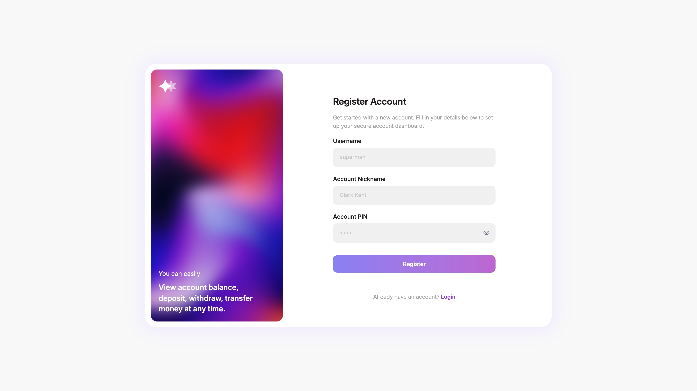
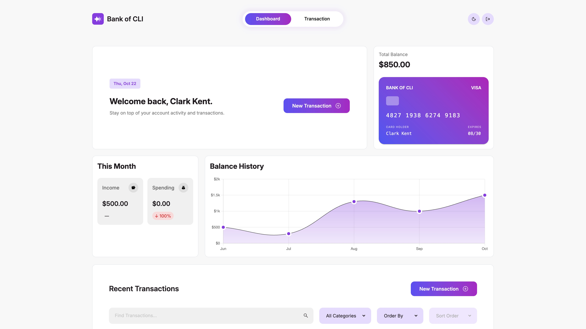

# Bank Of CLI 3

## Screenshots




## About

This repository holds our capstone project for our Revature Java Full Stack Engineering training. Bank of CLI (Part 3) is a full-stack web application, fully hosted on AWS, that integrates a Spring Boot REST API backend with the Angular frontend developed in [Part 2](https://github.com/AryamanTomer/Project-2-Bank-of-CLI). It transforms the standalone banking logic and client interface into a unified system where users can perform real-time transactions (such as registering, logging in, managing account balances, and transferring funds) backed by a live PostgreSQL database.

## How to run locally

- You need three things running at the same time:
  - PostgreSQL.
  - Java Spring Boot API Server.
  - Angular SPA.
- Start them in that order, each in its own terminal, and leave every terminal open while you use the app.
- When everything is up, open a browser to `http://localhost:4200`. The API listens on `http://localhost:8080`.

### What to install first

- **Java 25 or newer.** Check with `java -version`.
- **Node.js and npm.** Check with `node -version` and `npm -version`.
- **PostgreSQL**, running on your computer and listening on port `5432`.

### 1. Point the API at your database

- Open `bank3/src/main/resources/application.properties`.
- These three lines tell the API which database to use:

```properties
spring.datasource.url=jdbc:postgresql://${DB_HOST:localhost}:${DB_PORT:5432}/${DB_NAME:hibernate}
spring.datasource.username=${DB_USERNAME:postgres}
spring.datasource.password=${DB_PASSWORD:postgres}
```

- The API creates the tables itself the first time it starts.
- Make sure your PostgreSQL database, username, and password that match those values, or change the three lines to a database you already have. The database name in the URL is the word after the last slash (`hibernate`).
- If you'd like to run the database inside a Docker container, use the following command:

```bash
docker run -d \
  --name bank3 \
  -p 5432:5432 \
  -e POSTGRES_USER=postgres \
  -e POSTGRES_PASSWORD=postgres \
  -e POSTGRES_DB=hibernate \
  postgres:17
```

### 2. Make sure port 8080 is free

The API needs port 8080. If another program is already using it, the API will fail with `port already in use.` Stop that program, then start the API again.

### 3. Start the API

Open a terminal in the `bank3` folder.

On Windows:

```powershell
.\mvnw.cmd spring-boot:run
```

On macOS or Linux:

```bash
./mvnw spring-boot:run
```

Wait until the log says Tomcat started on port 8080. Leave this terminal open. The first start can take a minute while it downloads dependencies.

If Java is installed but the command cannot find it, set `JAVA_HOME` to your JDK folder and run the command again.

### 4. Start the Angular app

Open a second terminal in the `angular` folder.

```bash
npm install
npm start
```

`npm install` is only needed the first time, or after dependencies change. Wait until it says the app is serving at `http://localhost:4200`. Leave this terminal open.

### 5. Use the app

Open `http://localhost:4200` and register an account.

- The username and the display name must each be 20 characters or fewer.
- Remember the username and PIN. You will need them to log in.

On the dashboard, press **Enter** once. The page holds a loading state for up to 60 seconds, and Enter skips it.

From the dashboard you can deposit, withdraw, and transfer. A transfer needs the other person’s username. Signing out and opening the dashboard again sends you back to the login page.

The Notes box is shown while you enter a transaction, and it appears on the review step. The API does not store notes, so the text is gone after the history reloads.

### 6. Stop the app

Press `Ctrl+C` in all of your active terminals.
